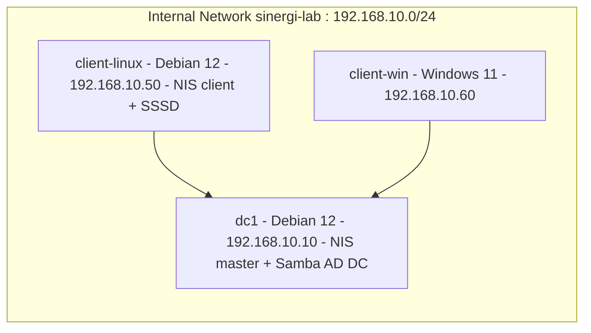
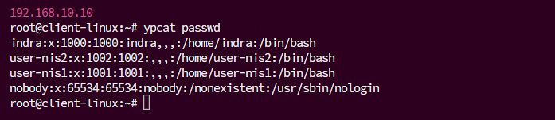
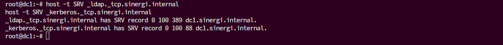
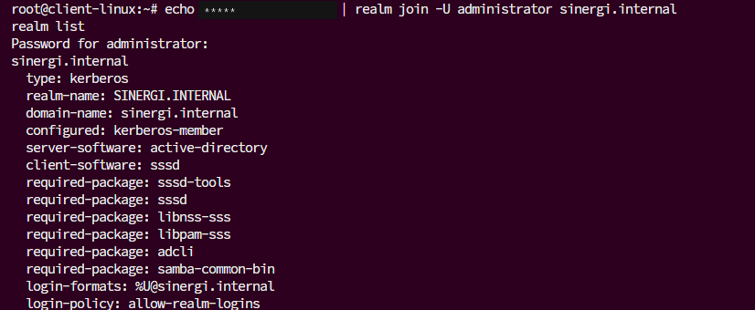
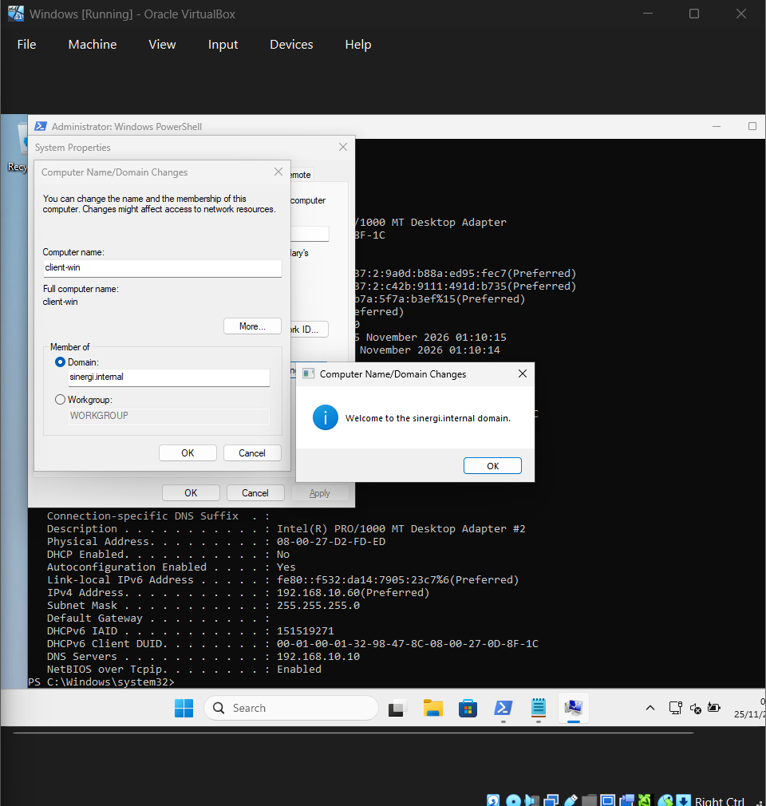
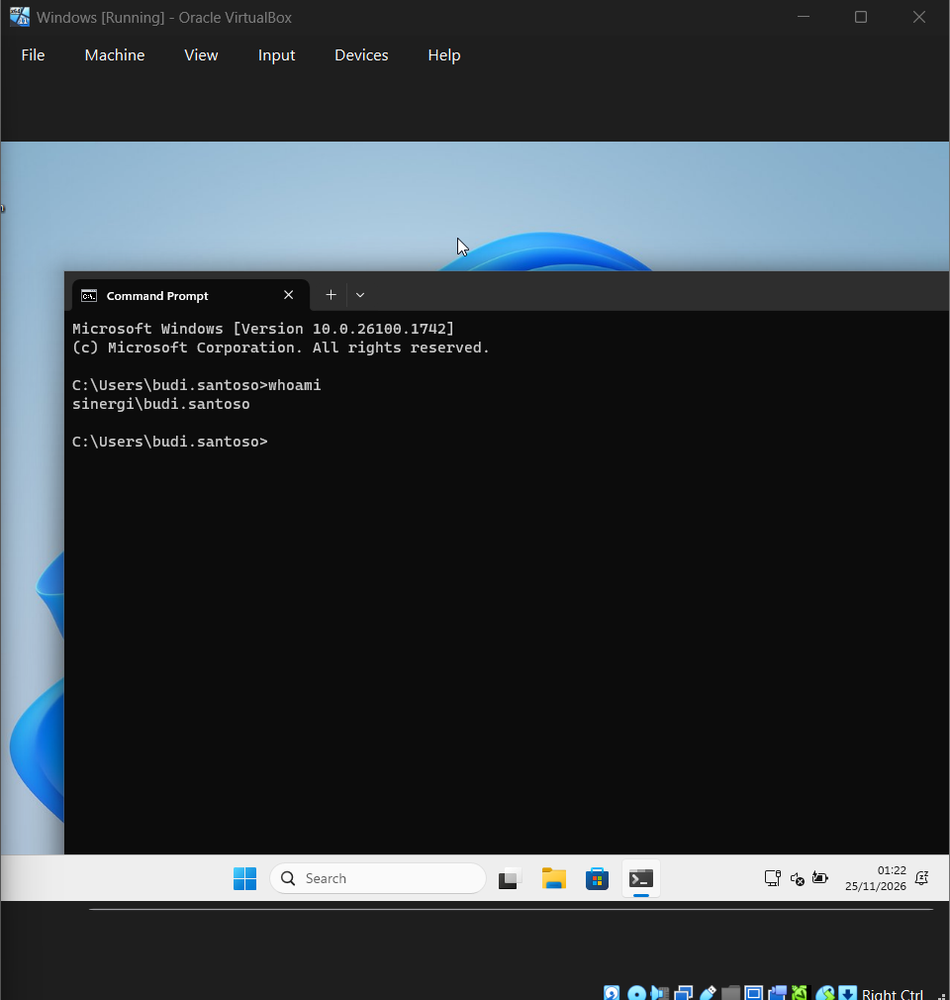

# SSO Lab: NIS dan Samba Active Directory (Debian 12 + Windows 11)

Dokumentasi lab layanan direktori dan otentikasi terpusat di VirtualBox. Ini lab di lingkungan virtual untuk belajar, bukan konfigurasi produksi. Semua password di repo ini sudah diganti placeholder dan screenshot yang memuat password sudah disensor.

## Masalah yang disimulasikan

Sebuah perusahaan fiktif dengan 150 staf masih mengelola akun secara lokal di tiap komputer. Setiap ada pegawai baru atau pergantian password, tim IT harus mengubahnya satu per satu. Lab ini memusatkan akun pada satu server dengan dua pendekatan: NIS (klasik) dan Samba 4 Active Directory (modern, berbasis LDAP, Kerberos v5, dan DNS SRV).

## Topologi



| VM | OS | IP | Peran |
|---|---|---|---|
| dc1 | Debian 12 (tanpa desktop) | 192.168.10.10 | NIS master, Samba AD DC, DNS |
| client-linux | Debian 12 (tanpa desktop) | 192.168.10.50 | NIS client, member domain (realmd + SSSD) |
| client-win | Windows 11 (build 10.0.26100) | 192.168.10.60 | Member domain |

Domain: `sinergi.internal`, realm: `SINERGI.INTERNAL`, NIS domain: `nis-sinergi`.

Setiap VM Debian memakai Adapter 1 (NAT) untuk mengunduh paket dan Adapter 2 (Internal Network `sinergi-lab`) untuk jaringan lab. dc1 dan client-linux dibuat sebagai linked clone dari satu base Debian 12. Rincian ada di [L.1](screenshots/L.1.png) dan [L.2](screenshots/L.2.png).

## Isi lab

1. **NIS master dan client.** `ypinit -m` di dc1, lalu `ypwhich` dan `ypcat passwd` di client (gambar 1.x sampai 4.x).
2. **Samba 4 AD DC.** Provisioning domain, Kerberos (`kinit`, `klist`), dan DNS SRV (`_ldap._tcp`, `_kerberos._tcp`) (gambar 5.x sampai 9.x).
3. **Domain join.** Linux dengan `realmd` + SSSD dan `pam_mkhomedir`, Windows lewat System Properties (gambar 10.x sampai 15.x).

## Hasil utama

| Bukti | Screenshot |
|---|---|
| Client terikat ke NIS master dan membaca akun dari server |  |
| Record SRV untuk LDAP (389) dan Kerberos (88) menunjuk ke dc1 |  |
| Linux berstatus `kerberos-member` |  |
| Windows bergabung ke domain |  |
| Login Windows dengan akun domain |  |

Seluruh screenshot ada di folder [screenshots](screenshots/) dengan nama sesuai nomor langkah.

## Kendala nyata dan penanganannya

| Kendala | Penyebab | Penanganan |
|---|---|---|
| `ypinit -m` menampilkan `RPC: Program not registered` ([2.2](screenshots/2.2.png)) | ypserv belum terdaftar di rpcbind saat peta NIS dibangun | Restart `rpcbind ypserv yppasswdd`, pastikan ypserv aktif, jalankan `cd /var/yp && make` bila perlu |
| Variabel `NISSERVER` tidak ada di `/etc/default/nis` ([1.2](screenshots/1.2.png)) | Di Debian 12 (paket nis 4.5) yang tersedia hanya `NISMASTER` | Biarkan `NISMASTER` kosong di master, peran master ditetapkan lewat `ypinit -m` |
| Penulisan `/etc/resolv.conf` ditolak `Operation not permitted` ([T.1](screenshots/T.1.png)) | Berkas kemungkinan terkunci atribut immutable | Periksa isi dengan `cat`, lepas atribut dengan `chattr -i` bila perlu diubah |
| Windows tidak menjangkau DC setelah IP diatur ([T.2](screenshots/T.2.png)) | IP salah ketik `192.169.10.60`, subnet berbeda dari DC | Ubah ke `192.168.10.60/24`, verifikasi dengan `ipconfig /all` ([13.1](screenshots/13.1.png)) |

## Struktur repo

```
sso-samba-ad-lab/
├── README.md
├── .gitignore
├── screenshots/   bukti per langkah (1.1.png, 1.2.png, ...)
├── scripts/       perintah lab dalam bentuk skrip (tanpa password)
├── configs/       konfigurasi dan output verifikasi per VM
└── docs/
```

## Catatan keamanan

- Password tidak disimpan di repo. Skrip meminta password lewat prompt.
- Domain `sinergi.internal` dan IP 192.168.10.0/24 bersifat fiktif dan privat.
- Jangan memakai konfigurasi ini apa adanya di produksi. NIS tidak mengenkripsi lalu lintasnya, dan password pada contoh hanya untuk lab.

## Referensi

- Samba Wiki, [Using a Group Policy Preference](https://wiki.samba.org/index.php/Using_a_Group_Policy_Preference)
- Red Hat, [Enabling offline authentication](https://docs.redhat.com/en/documentation/red_hat_enterprise_linux/9/html/configuring_authentication_and_authorization_in_rhel/assembly_additional-configuration-for-identity-and-authentication-providers_configuring-authentication-and-authorization-in-rhel)
- RFC 4120, [The Kerberos Network Authentication Service (V5)](https://www.rfc-editor.org/rfc/rfc4120)
